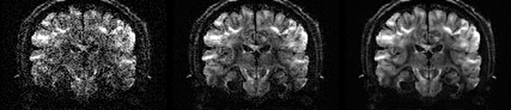
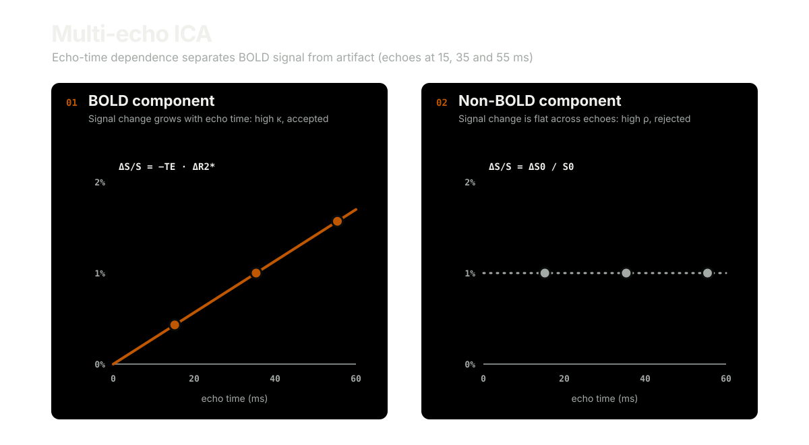

# Denoising

Noise limits what can be measured in every voxel. Denoising separates signal from noise using structure the noise lacks: redundancy across many volumes, or the physics of how signal changes with echo time.

## Diffusion denoising

Diffusion MRI acquires many volumes of the same anatomy. Within a small patch, the signal is described by a few principal components, while thermal noise spreads across all of them. Principal component analysis (PCA) denoising keeps the signal components and suppresses the rest. Small voxels and high b-values make raw images noisy, so these gains matter most for modern high-resolution acquisitions.

The popular Marchenko–Pastur PCA (MPPCA) method, implemented in MRtrix3 `dwidenoise`, relies on patented algorithms and is licensed for non-commercial research only. `svht_denoise` instead builds on earlier, unencumbered work: the singular value rules of Gavish and Donoho with overlapping patches (Manjón et al.), so no noise level has to be supplied. Its authors believe it falls outside those patents. It reduces the Rician noise floor of magnitude images, accepts phase data to avoid that floor entirely, and can also remove Gibbs ringing, matching MRtrix3 `mrdegibbs` about 1.5× faster.

<!-- figure-tsv: benchmark-svht.tsv -->

## Multi-echo ICA

Independent component analysis (ICA) splits fMRI data into components, but with a single echo each component must be judged by its spatial and temporal features alone. With three or more echoes, components can be classified by physics. Blood-oxygen-level-dependent (BOLD) signal changes T2*, so its amplitude scales with echo time (κ). Artifacts such as head motion change the initial signal intensity (S0), so their amplitude does not (ρ). Multi-echo ICA (ME-ICA) uses these scores to reject noise components objectively and automatically.

`meica` ports [tedana](https://tedana.readthedocs.io/) to Rust as a native executable and as WebAssembly, so it runs in a browser without Python. Outputs match tedana's to floating-point rounding with identical classifications, using about half the memory.

<!-- figure-tsv: benchmark-meica.tsv -->

## Links

- [Gavish and Donoho (2014)](https://arxiv.org/abs/1305.5870) derive the optimal hard threshold for singular values.
- [Gavish and Donoho (2017)](https://arxiv.org/abs/1405.7511) derive optimal singular value shrinkage.
- [Manjón et al. (2013)](https://pubmed.ncbi.nlm.nih.gov/24019889/) introduce overcomplete local PCA denoising of diffusion images.
- [Veraart et al. (2016)](https://pubmed.ncbi.nlm.nih.gov/27523449/) describe MPPCA denoising.
- [Kundu et al. (2012)](https://doi.org/10.1016/j.neuroimage.2011.12.028) separate BOLD and non-BOLD signals using multi-echo EPI.
- [DuPre et al. (2021)](https://doi.org/10.21105/joss.03669) describe tedana.
- [svht_denoise](https://github.com/rordenlab/svht_denoise) provides C source code under the MPL-2.0 license.
- [meica-rs](https://github.com/niivue/meica-rs) provides Rust source code under the LGPL-2.1 license.
